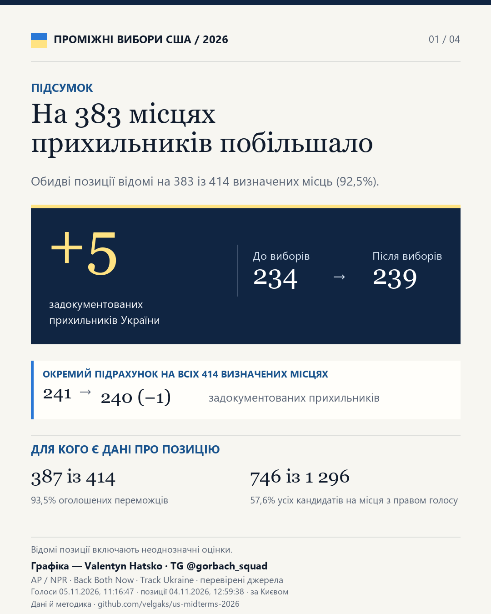
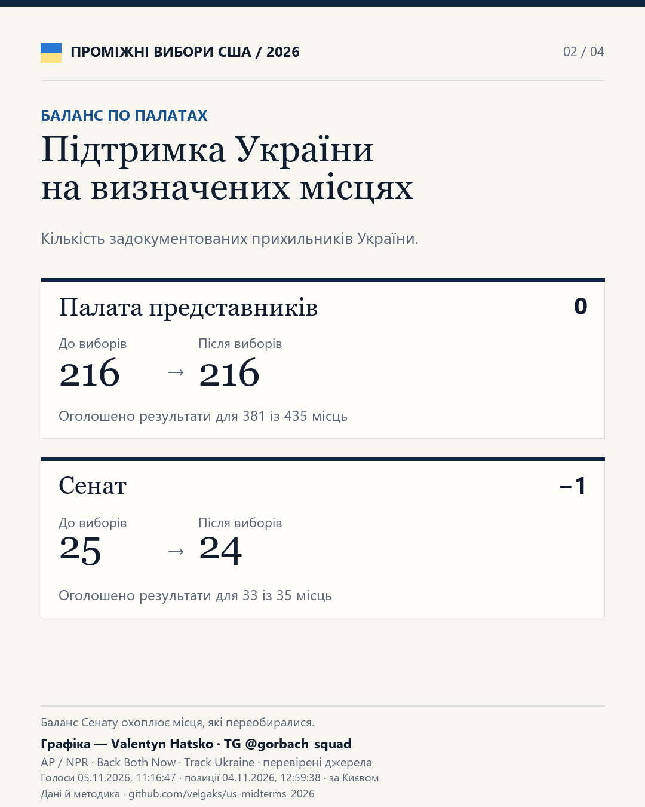
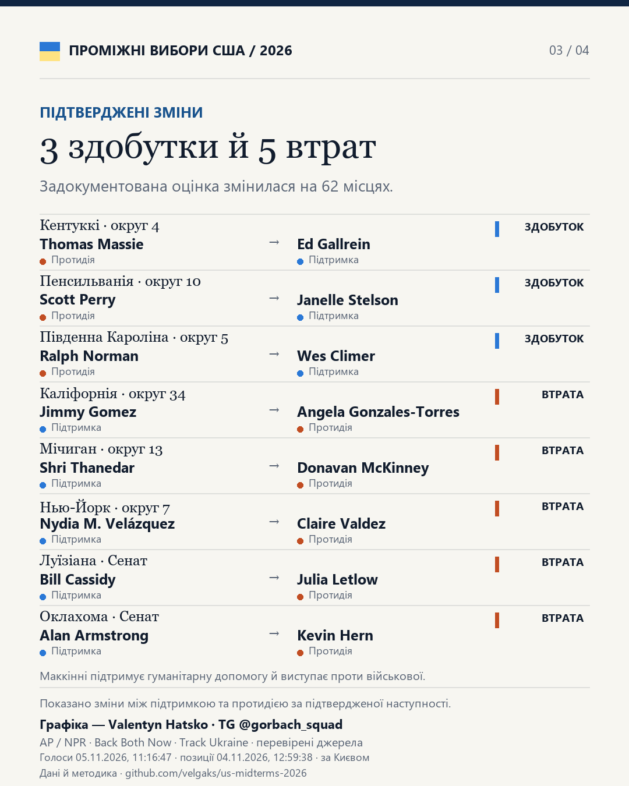
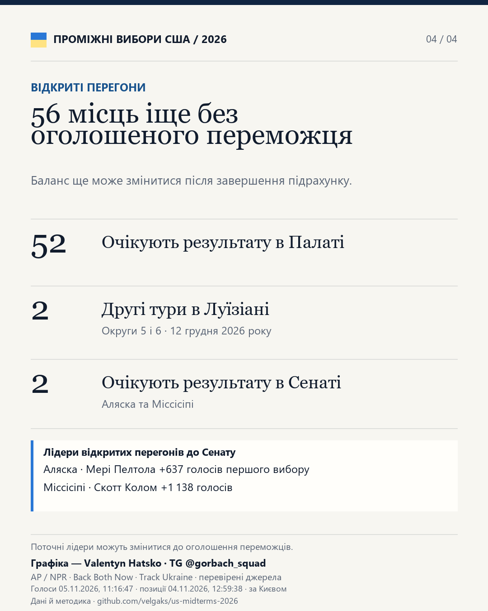

# [Відкрити інтерактивний дашборд](https://velgaks.github.io/us-midterms-2026/dashboard.html)

На **383 місцях**, де відомі позиції і попередника, і переможця, кількість задокументованих прихильників України зросла **з 234 до 239 (+5)**.

- **414 із 470 місць (88,1%)** мають оголошений результат.
- Для **406 із 414 попередників (98,1%)** і **387 із 414 переможців (93,5%)** відома позиція.
- На **383 із 414 місць (92,5%)** відомі обидві позиції. Серед усіх кандидатів на місця з правом голосу позицію задокументовано для **746 із 1 296 (57,6%)**.

До відомих позицій зараховуємо підтримку, протидію та неоднозначну позицію. Окремий підрахунок по всіх **414 місцях з оголошеним результатом** показує **241 → 240 (−1)**.

Голоси оновлено станом на **5 листопада 2026 року, 11:16:47 за Києвом**. На 56 місцях ще очікують на переможця, зокрема у двох округах Луїзіани з другим туром.

Результати взято з потоку AP через NPR. Для позицій використано Back Both Now (версія 16d), картки Track Ukraine, поіменні голосування, анкети та прямі заяви. Зріз позицій зафіксовано 4 листопада о 12:59:38 за Києвом. [Потоки результатів, реєстри й джерела оцінок](https://velgaks.github.io/us-midterms-2026/#sources)

[Головна сторінка](https://velgaks.github.io/us-midterms-2026/) · [Методика та джерела](https://velgaks.github.io/us-midterms-2026/#method)

## Візуальний підсумок

  
  

  
  

